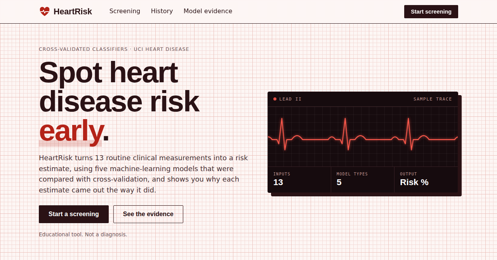
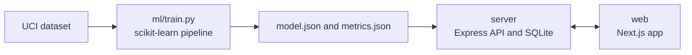
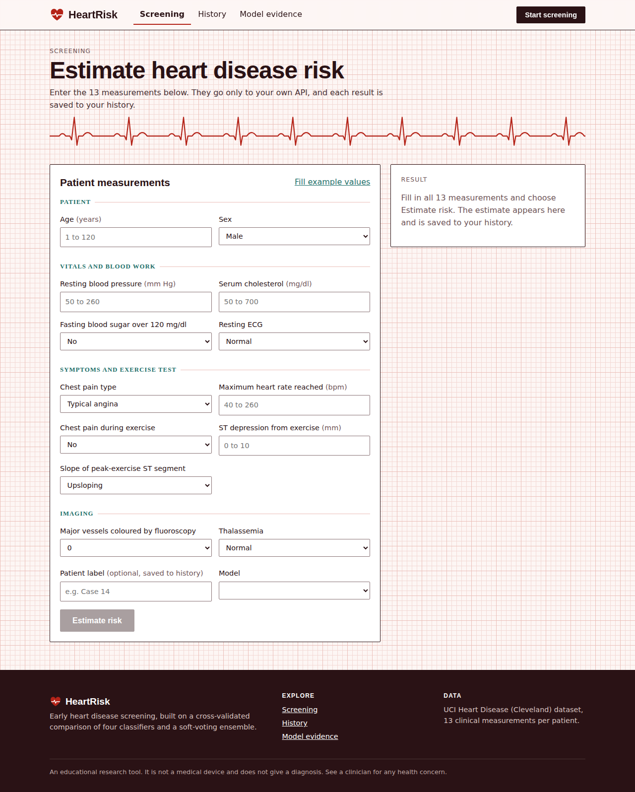

# HeartRisk: Early Heart Disease Screening with Cross-Validated Classifiers

Project report and working web application based on the paper *"Cross-Validated Comparison of Four Classifiers for Heart Disease Prediction in Initial Stages"*.

Authors: _add names here_ · Institution: _add here_ · Date: _add here_



## 1. Abstract

Heart disease is easier to treat when it is found early, and routine clinical measurements already carry much of the signal. This project compares four classifiers (Logistic Regression, Random Forest, XGBoost and a Support Vector Machine) and a soft-voting ensemble on the UCI Heart Disease dataset, using cross-validation as well as a held-out test split. The best models are then served through a web application that returns a risk estimate for a new patient, shows how every model scored them, and explains which measurements moved the estimate. The tool is educational and is not a diagnostic device.

## 2. Problem and dataset

**Task.** Binary classification: does a patient have heart disease, given 13 routine measurements?

**Data.** UCI Heart Disease, Cleveland subset ([source](https://archive.ics.uci.edu/dataset/45/heart+disease)), downloaded with `ucimlrepo` (dataset id 45). The original diagnosis (`num`, 0 to 4) is turned into a binary label: `num > 0` means disease. Rows with missing values are dropped (the Cleveland file has 303 patients, 6 with missing values, leaving 297).

| Feature | Meaning | Values |
|---|---|---|
| `age` | Age in years | 1 to 120 |
| `sex` | Sex | 1 male, 0 female |
| `cp` | Chest pain type | 1 typical angina, 2 atypical, 3 non-anginal, 4 none |
| `trestbps` | Resting blood pressure (mm Hg) | 50 to 260 |
| `chol` | Serum cholesterol (mg/dl) | 50 to 700 |
| `fbs` | Fasting blood sugar over 120 mg/dl | 0 no, 1 yes |
| `restecg` | Resting ECG | 0 normal, 1 ST-T abnormality, 2 left ventricular hypertrophy |
| `thalach` | Maximum heart rate reached (bpm) | 40 to 260 |
| `exang` | Chest pain during exercise | 0 no, 1 yes |
| `oldpeak` | ST depression from exercise (mm) | 0 to 10 |
| `slope` | Slope of the peak-exercise ST segment | 1 up, 2 flat, 3 down |
| `ca` | Major vessels coloured by fluoroscopy | 0 to 3 |
| `thal` | Thalassemia | 3 normal, 6 fixed defect, 7 reversible defect |

## 3. Method

1. **Split.** 80% training, 20% test, stratified on the label, `random_state=42`.
2. **Preprocessing.** `StandardScaler` fitted on the training data inside every scikit-learn `Pipeline`, so nothing leaks from the test set.
3. **Models.** Logistic Regression, Random Forest, XGBoost, SVM (RBF or linear kernel), each with default settings.
4. **Tuning.** 5-fold grid search on accuracy, training data only.
   - Random Forest: `n_estimators` in {50, 100, 200}, `max_depth` in {None, 5, 10}
   - SVM: `C` in {0.1, 1, 10}, `kernel` in {linear, rbf}
5. **Ensemble.** Soft voting over Logistic Regression, tuned Random Forest and tuned SVM (average of predicted probabilities).
6. **Evaluation.** Accuracy, precision, recall, F1 and ROC AUC on the test set, plus 5-fold stratified cross-validated accuracy on the training set. With under 100 test patients, one error moves accuracy by more than a point, so cross-validated accuracy is the fairer way to compare models.

## 4. Results

Results are generated from a real training run so the report cannot drift from the code:

```bash
cd ml && python train.py && python make_report.py
```

This writes [`docs/RESULTS.md`](docs/RESULTS.md) with the full comparison table, confusion matrices and feature importances. If the figures in the paper differ from the figures in `docs/RESULTS.md` (different split, tuning grid or library version), report both and state the reason.

## 5. System design



- **`ml/`** trains and evaluates the models, then exports the fitted pipelines (scaler, coefficients, trees, support vectors) as plain JSON.
- **`server/`** loads that JSON and predicts in JavaScript, so Python is only needed for training. It validates inputs, stores every assessment in SQLite (Node's built-in `node:sqlite`) and serves the API.
- **`web/`** is a Next.js (App Router) front end: landing page, screening form, history, and a model-evidence page.
- **Explanations.** For each prediction the server swaps one measurement at a time for the training-set average and reports how far the probability moves. This is an approximation, not SHAP.

## 6. Features

- Risk estimate with a probability, a low / moderate / high band and a plain-language meaning.
- Side-by-side scores from every live model, with an agree / disagree verdict.
- "Why this estimate": the eight measurements that moved the result the most.
- Saved history with delete, delete-all and CSV export (formula-injection safe).
- Model-evidence page: metrics table, ROC curves, feature importance.
- Printable result, responsive layout, reduced-motion support, keyboard and screen-reader friendly markup.



## 7. API

| Method | Path | Purpose |
|---|---|---|
| GET | `/api/health` | Server and model status |
| GET | `/api/models` | Live models and the default |
| GET | `/api/metrics` | Evaluation metrics and feature importance |
| POST | `/api/predict` | Body: `{ inputs, model?, label?, save? }`. Returns `probability`, `risk_band`, `comparison`, `factors`, `id` |
| GET | `/api/assessments` | Saved assessments, newest first |
| GET | `/api/assessments/:id` | One assessment |
| DELETE | `/api/assessments/:id` | Delete one |
| DELETE | `/api/assessments` | Delete all |

Inputs are validated (ranges, whole numbers, allowed `thal` values) and rejected with HTTP 422 and a message naming the field.

## 8. Project structure

```
ml/        train.py, export.py, make_report.py, check_parity.py
server/    src/index.js, src/infer.js, src/db.js, test/infer.test.mjs, data/
web/       app/ (pages), components/, lib/
docs/      RESULTS.md (generated), screenshots/
```

## 9. Setup and run

Requirements: Python 3.10+, Node 22.13+.

```bash
# 1. Train and export (downloads the UCI data once; or: python train.py your.csv)
cd ml && pip install -r requirements.txt && python train.py && python make_report.py

# 2. API on http://localhost:4000
cd ../server && cp .env.example .env && npm install && npm start

# 3. Web on http://localhost:3000
cd ../web && cp .env.example .env.local && npm install && npm run dev
```

## 10. Testing and verification

```bash
cd server && npm test            # unit tests for the JavaScript predictor (hand-built models, no training needed)
cd ml && python check_parity.py  # trains small models, exports them, and checks JavaScript against scikit-learn
```

- Logistic Regression and Random Forest predictions match scikit-learn exactly. SVM and ensemble probabilities agree to within about 0.3 percentage points, because scikit-learn's own `predict_proba` differs slightly from its decision function. No predicted class changes.
- XGBoost is evaluated and reported, but it is not available for live prediction because its trees are not exported.

## 11. Limitations and ethics

- About 300 patients from one centre: estimates are rough, and the models are not validated on other populations.
- This is an educational tool, not a medical device. It does not give a diagnosis, and every result says so.
- There is no login. Add authentication, consent and encryption before storing any real patient data. The `.gitignore` keeps the local database out of Git.
- The explanations describe the model, not biology, and they are approximate.

## 12. Future work

SHAP explanations, live XGBoost prediction, probability calibration, external validation on other datasets, user accounts, and container packaging.

## 13. References

- *Cross-Validated Comparison of Four Classifiers for Heart Disease Prediction in Initial Stages* (the paper this project implements).
- Janosi, A., Steinbrunn, W., Pfisterer, M., Detrano, R. *Heart Disease* dataset. UCI Machine Learning Repository, 1988.
- Pedregosa et al. Scikit-learn: Machine Learning in Python. JMLR 12, 2011.
